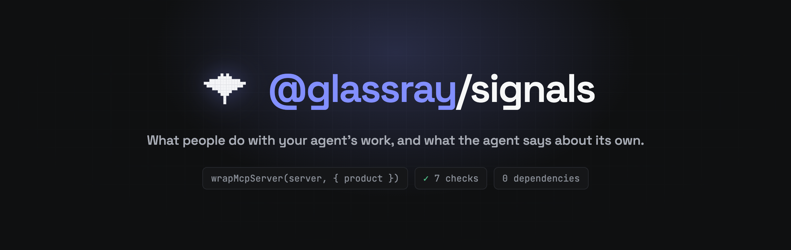
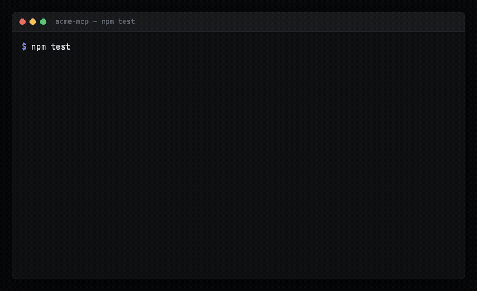

<div align="center" id="top">



[](https://glassray.ai)
[](LICENSE)

[](package.json)
[](package.json)
[](#-mcp-servers-in-one-line)
[](https://agentskills.io)

</div>

# @glassray/signals

**Your agent hits a broken tool, works around it, and says nothing. This package is the wiring that
gets that report out, the wording that makes an agent send it, and a check that proves it arrived.**

Glassray collects two things about an agent's work: what the people using it do and say, and what
the agent says about its own work. It links the two by work item, investigates when people are
unhappy, and groups the causes into issues a coding agent can fix. This package is how both reach
it, in one line for an MCP server.

## Why this exists

In one session we watched, an agent hit four problems in the product it was using: a guide that
contradicted a tool's schema, a missing parameter that made it send 1.2 KB of markup to change
eight bullet glyphs, and two rounds of guessing argument names. It invented a workaround for every
one and reported none. Asked afterwards why, it said: "the failures were self-healing, so none of
them felt like getting stuck."

A later session had the wording that answers that, and still reported nothing until it was asked
outright, when it said: "I hit three things worth reporting and each time I invented a workaround
and moved on instead of taking the extra call."

Both runs had somewhere to put a report. Neither used it. So the tools here ship with the paragraph
agents read when they connect, the required fields that are harder to skip than a polite request,
and a check that tells you which of the two is missing from your server.

## 📡 What a signal is

A signal is one thing said or done about an agent's work, and it carries a `source`:

- `user`: what a person did or said about the work. An undo, a regenerate, an edit, a rating, a reply.
- `agent`: what the agent said about its own work. A tool that failed, input that came back cut off, a guess it had to make.

Glassray links the two by work item, investigates when people are unhappy, and groups the causes
into issues a coding agent can fix. Signals from users decide what matters; signals from agents
explain why.

Calls return at once and never throw. Signals are batched and sent in the background, so a Glassray
outage cannot break your product, and the package has no runtime dependencies.

## 🎬 The check, before and after

<p align="center"></p>

That is `checkMcpServer` run twice against the same small server, first as written and then after
adding the one `wrapMcpServer` line. It is a real run; [docs/demo.html](docs/demo.html) renders the
animation and the frames are captured from it.

| | Before | After |
| --- | --- | --- |
| Checks passed | 0 | 7 |
| Checks failed | 3 | 0 |
| Signals captured | 0 | 2 |

## 🚀 Quickstart

**1. Install.** Not on npm yet, so install from this repository:

```sh
npm install github:glassray/glassray-signals-js
```

**2. Get a key** in the Glassray dashboard, under Settings → API keys. A signals key can only send.

**3. Start it** once, wherever your process starts:

```ts
import { init } from "@glassray/signals";

init(); // reads GLASSRAY_API_KEY and GLASSRAY_ENDPOINT
```

Without a key every call does nothing, so the calls can stay in your code in every environment.

**4. Send what happens:**

```ts
import { signal } from "@glassray/signals";

// a person threw away what the agent made
signal({ source: "user", kind: "undo", work_item: { type: "canvas", id: canvasId }, refs: { user: userId } });

// the agent says what went wrong
signal({ source: "agent", kind: "tool_failure", tool: "insert_instance", message: "PricingCard not found; drew rectangles instead" });
```

`work_item` is your own unit of work, such as a canvas, a report or a ticket. It is how Glassray
links what a person did to what the agent said while doing it.

Kinds for signals from users are free text, and the well-known ones get a sentiment on arrival:
`regenerate`, `correction`, `undo`, `replaced_agent_work`, `needs_review`, `thumbs_down`, `export`,
`ready_for_dev` and others. Signals from agents always carry a `message`, and `AGENT_KINDS` lists
the well-known ones. Kind and source are independent.

### Say who and what once

Signals sent inside `withContext` inherit its user, work item, session, trace and agent. Explicit
fields on a signal still win.

```ts
import { withContext, setContext } from "@glassray/signals";

setContext({ agent: { name: "report-writer", version: "3.9" } }); // for the whole process

await withContext({ user: userId, workItem: { type: "report", id: reportId } }, () => handleRequest());
```

Where the runtime exposes `node:async_hooks` through `process.getBuiltinModule` it uses
`AsyncLocalStorage`, so the context follows async work. Elsewhere it falls back to a synchronous
stack, which is right for synchronous code and best effort across an `await`.

## 🔌 MCP servers in one line

Call `wrapMcpServer` right after creating the server and before registering any tools, because it
wraps `registerTool`:

```ts
import { wrapMcpServer } from "@glassray/signals/mcp";

const server = new McpServer({ name: "acme", version: "1.0.0" });
wrapMcpServer(server, {
  product: "Acme",
  context: ({ args }) => ({ user: currentUser.id, workItem: args.doc_id && { type: "doc", id: String(args.doc_id) } }),
});
```

That adds three tools. `report_issue` and `share_feedback` carry what the agent says about your
product. `pass_on_user_reaction` carries what the person said about the agent's work in the agent's
own chat, word for word, which your product never sees otherwise.

`report_issue` asks its three questions as required fields rather than as a request in prose: what
you needed, what you tried, and, optionally, what would fix it. A required field is harder to skip
than a polite instruction, and the optional one gives an agent somewhere to put a tool signature it
has already worked out.

The wrapper also adds a paragraph to the server's instructions telling agents to use those tools as
they work and not to ask the person first. Agents that are not told this tend to ask
permission first, and agents that recover from a problem tend to read themselves as never having
been stuck. Your own instructions stay first.

Every tool call then runs inside a context holding the person, the work item and the agent client
from the MCP handshake, so a bare `signal()` inside a tool fills them in. Each call also leaves a
breadcrumb: tool, ok or failed, the error, and how long it took. Signals from agents carry the last
few, so a report arrives with the calls that led to it, which is the record of what happened next to
the agent's account of it.

Needs `@modelcontextprotocol/sdk` and `zod`, which an MCP server already has. Both are optional
peers, so the core of the package installs without them.

### If your server already has a report tool

Keep it. Turn ours off, name yours, and send a signal from inside it:

```ts
wrapMcpServer(server, { product: "Acme", reportTools: false, ownReportTool: "report_issue" });
```

To let the person's words travel on a tool of your own, add our fields to it. Any call that carries
them is sent as a signal from the user:

```ts
import { userReactionFields } from "@glassray/signals/mcp";
server.registerTool("save_decision", { inputSchema: { doc_id, decision, ...userReactionFields } }, handler);
```

If you set the server's instructions somewhere else, such as a guide tool, `glassrayInstructions({ product })`
returns the same paragraph to append.

This package sends no traces. If you trace, with `@glassray/tracing`, OpenTelemetry or anything
else, put the trace id in the context with `withContext({ trace: traceId }, ...)` inside your
tracing wrapper, and Glassray links each signal to the exact spans.

## 🧪 Check it in your tests

```ts
import { checkMcpServer, formatChecks } from "@glassray/signals/testing";

const result = await checkMcpServer(() => buildServer(testUser), {
  failingCall: { tool: "get_doc", args: { doc_id: "missing" } },
});
assert.ok(result.ok, formatChecks(result));
```

It connects to your server in memory, plays a short scripted session against a stand-in Glassray (a
tool fails, the agent reports it, the person complains), and checks what an agent would read and
what would be sent. Nothing leaves your machine.

The failures name what is missing and how to fix each one, for example: "Nothing passes on
what the person says in the agent's chat, which is where most reactions happen. Leave reactionTool
on in wrapMcpServer, or add userReactionFields to your own tools."

What it cannot tell you is whether a real agent will follow the instructions. That needs a live run
with a model, and it has gone both ways: of three sessions we have watched on a wired-up server,
one reported without being asked.

## 🤖 Let your coding agent set it up

```sh
npx @glassray/signals setup
```

copies the `glassray-setup` skill into `.claude/skills/`, or into any folder with `--to`. Then ask
Claude Code, Cursor or Codex: "Set up Glassray in this repo using the glassray-setup skill." The
skill walks it through finding your unit of work, wrapping the MCP server, hooking what people do to
the agent's work, and proving it with `checkMcpServer` and one test per hook.

## ⚙️ Options for `init`

| Option | Default | |
| --- | --- | --- |
| `apiKey` | `GLASSRAY_API_KEY` | Without a valid key nothing is sent. |
| `endpoint` | `GLASSRAY_ENDPOINT`, then `https://app.glassray.ai` | |
| `enabled` | `true` | Turn sending off without removing calls. |
| `beforeSend` | | Edit a signal, or return `null` to drop it. Runs after context is filled in. |
| `sampleRate` | `1` | Share of signals kept. |
| `onError` | one `console.warn` per minute | Pass `() => {}` for silence. |
| `maxQueue` | `2000` | Signals held while Glassray is unreachable; further ones are dropped. |

Call `await flush()` before a short-lived process exits, such as a script or a serverless function.

## 📦 What's in the repository

| Path | What it holds |
| --- | --- |
| [src/index.ts](src/index.ts) | `init`, `signal`, `flush`, the context, the client |
| [src/mcp/](src/mcp/) | `wrapMcpServer`, the report and reaction tools, the instructions paragraph, breadcrumbs |
| [src/testing/](src/testing/) | `checkMcpServer` and `formatChecks` |
| [skills/glassray-setup/](skills/glassray-setup/) | The skill a coding agent reads to wire this up and prove it |
| [docs/demo.html](docs/demo.html) | Renders the animation above; `docs/demo.gif` is captured from it |
| [scripts/smoke.mjs](scripts/smoke.mjs) | Loads the built package and sends one signal, run on every Node version in CI |
| [SECURITY.md](SECURITY.md) | What this sends and where, the install script, and how to report a hole |

## 🤝 Contributing

This package is developed in Glassray's monorepo and mirrored here, so a pull request against this
repository is overwritten by the next sync. Open an issue, and see [CONTRIBUTING.md](CONTRIBUTING.md).

MIT licensed, see [LICENSE](LICENSE).

<p align="right"><a href="#top">⬆️ Back to top</a></p>
